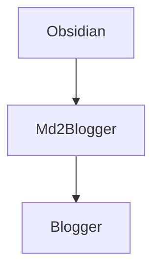

# Welcome to My Blog Post (v 2)

This is a paragraph with **bold text**, *italic text*, and ***bold italic*** together.

## A Section with Links

#### Relative Link  
#### URL
Go to [Google](https://www.google.com) for more info.

Here's a [[Some Page|custom display text]] wikilink.

### Code Examples

Inline code looks like `console.log("hello")` in a sentence.

```python
def greet(name):
    """Say hello."""
    print(f"Hello, {name}!")

greet("World")
```

## Lists

### Unordered List

- First item with **bold**
- Second item with *italic*
  - Nested item
  - Another nested item
- Third item

### Ordered List

1. Step one
2. Step two with `inline code`
3. Step three

### Task List

- [x] Completed task
- [ ] Pending task
- [ ] Another pending task

## Blockquote

> This is a blockquote with **bold** inside it.
> It can span multiple lines.

> [!note] Important Note
> This is an Obsidian callout that should render nicely.

## Table

| Feature       | Status    | Notes              |
|---------------|-----------|---------------------|
| Markdown      | ✅ Done   | Core parsing works  |
| Tables        | ✅ Done   | With inline styles  |
| **Images**    | ✅ Done   | Obsidian + standard |

## Images

![[my-screenshot.png]]


## Horizontal Rule

---

## Highlighted Text
^highlights

This has ==highlighted text== in the middle of a sentence.

## Strikethrough

This is ~~deleted text~~ in a paragraph.

## Block References

This section links back to the [highlighted text section](#^highlights) above.

## Callouts

> [!hint] Callout Title
> This is some text
>
> - with bullet points

> [!warning] Mind the gap
> Each callout type has its own colour and icon.

> [!faq]- A folded question
> Readers click the title to open this one.

> [!question] Can callouts be nested?
> > [!success] Yes, they can.

## Highlight Colours

==🔴Important==, ==🟠Follow up==, ==🟡Remember this==, ==🟢Completed==, ==🔵Reference== and ==🟣Idea==.

## Footnotes

Footnotes are numbered automatically[^1], and can be written inline too.^[Like this one.]

[^1]: This is the referenced text.

## Comments

This sentence has a hidden %%private%% comment.

%%
This whole block is a comment and does not appear in the post.
%%

## Tags

This post is filed under #obsidian and #blogging/how-to.

## Maths

Euler's identity is $e^{i\pi} + 1 = 0$.

$$
\frac{a}{b} = c
$$

## More Task Statuses

- [x] Done
- [-] Cancelled (any character marks a task as done)
- [ ] Still to do

## Image Sizes

![[my-screenshot.png|300]]

## Links Within the Post

Jump back to [[#Lists]] or to the [[#^highlights|highlighted text]].

## Diagram



## Final Thoughts

That's all for now. This post was converted from **Obsidian** to **Blogger** automatically!


